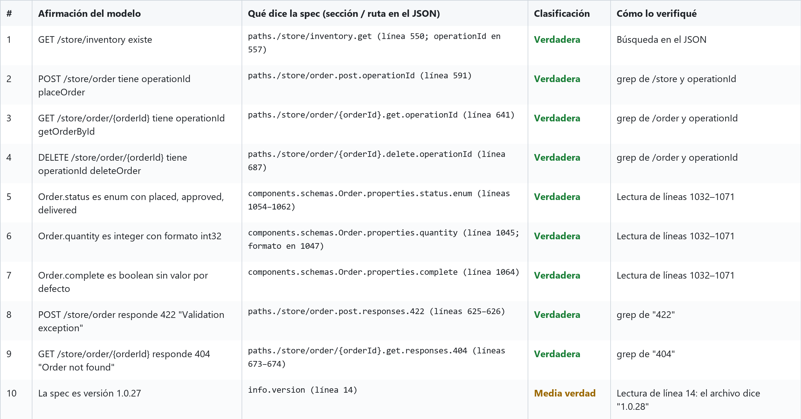

# Verificación de afirmaciones: Swagger Petstore v3 (órdenes de la tienda)

Fuente local: `petstore-openapi.json` (versión 1.0.28)

## Conclusión

- 9 de 10 afirmaciones coinciden exactamente con `petstore-openapi.json`, así que son confiables; ninguna resultó inventada.
- La única imprecisión fue la versión: se citó 1.0.27 tomándola de la URL en vivo, pero el archivo local es 1.0.28, por lo que la afirmación se clasifica como "media verdad".
- El único tipo de error fue "versión mezclada" (1 de 10); no hubo errores en endpoints, campos, tipos, enums ni códigos de respuesta.
